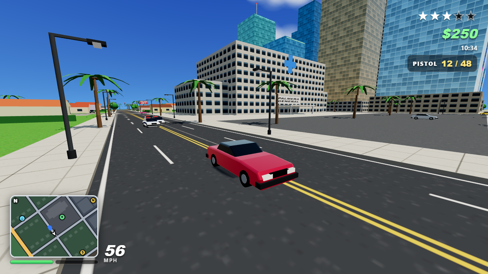
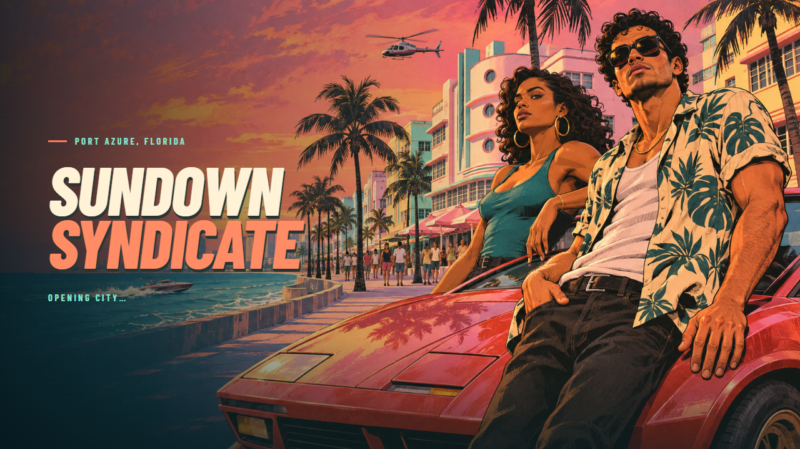
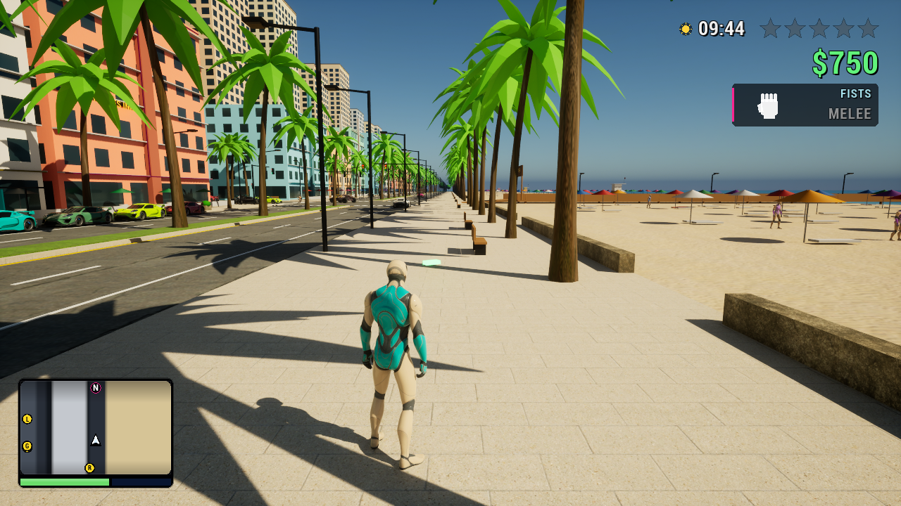
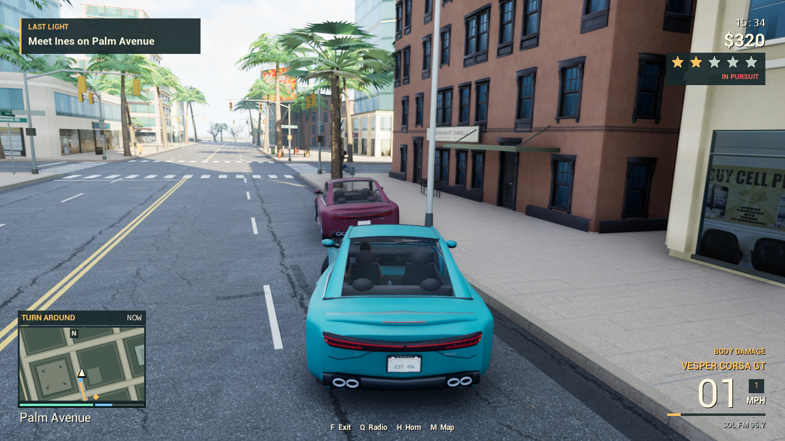

# Claude vs ChatGPT: AI-made open-world crime games

Two AI models got the exact same prompt and the same amount of time to make an open-world crime game in the style of GTA.
Every file here was written by the AI. Nothing was fixed by hand.

Watch the video: https://youtu.be/JtPId3Alu9o

## Play in your browser (Round 1: one hour each)

| | Claude Fable 5.2 | GPT-6.2 Astra (ChatGPT) |
|---|---|---|
| Game | **Palmera Heat** | **Sundown Syndicate: Port Azure** |
| Play | [Play now](https://modelbehavioryt.github.io/claude-vs-chatgpt-ai-games/browser/claude/) | [Play now](https://modelbehavioryt.github.io/claude-vs-chatgpt-ai-games/browser/chatgpt/) |
| Code | [`browser/claude`](browser/claude) | [`browser/chatgpt`](browser/chatgpt) |

Controls: WASD to move, mouse to look, Shift to sprint, Space to jump, F to enter or leave a car, click to shoot.

To run one locally, serve the folder over http (for example `npx serve browser/claude`) and open it in Chrome.

## Unreal Engine 5.8 (Round 2: two hours each)

Download from the [Releases page](../../releases/latest):

| File | What it is |
|---|---|
| `ChatGPT-GPT-6.2-Astra-Sunbreak-Windows.zip` | ChatGPT's game, ready to play. Unzip and run `Sunbreak.exe`. |
| `Claude-Fable-5.2-NeonCoast-Windows.zip` | Claude's game, ready to play. Unzip and run `StarterGame.exe`. |
| `ChatGPT-GPT-6.2-Astra-Sunbreak-UnrealProject.zip` | ChatGPT's full Unreal project (C++, content, build scripts). |
| `Claude-Fable-5.2-NeonCoast-UnrealProject.zip` | Claude's full Unreal project (C++, content, build scripts). |

The playable builds are Windows only. To open a project you need Unreal Engine 5.8 and Visual Studio 2022. Open
`StarterGame.uproject` and let it compile.

The games themselves are exactly as the AIs left them. One change was made after the test: Claude's project loads some
materials by name from code, and the packager skips those by default, so its playable build came out all white. Four
`DirectoriesToAlwaysCook` lines were added to its `Config/DefaultGame.ini` to fix that. ChatGPT packaged its own build
during its two hours.

## How the test worked

- **Same prompt for both.** The exact prompts are in [`prompts/`](prompts).
- **Same time, started on the same second.** One hour in the browser, two hours in Unreal.
- **No human help.** Claude Fable 5.2 ran in Claude Code and GPT-6.2 Astra ran in Codex, both fully on their own.
- **Same Unreal starting point.** Both started from Epic's official third-person template with an empty C++ module, plus
  the same three helper tools in [`unreal-tools/`](unreal-tools). The tools let an AI compile, run editor Python headless
  and take screenshots of its own game.

## Credits and licenses

- The code the AIs wrote is released under the MIT license (see [LICENSE](LICENSE)).
- three.js: MIT. Fonts in ChatGPT's browser game: SIL Open Font License (license files included).
- ChatGPT's Unreal game uses CC0 assets from [Poly Haven](https://polyhaven.com/license) and the
  [MakeHuman](https://www.makehumancommunity.org/) CC0 system assets. Full list in its `Credits.txt`.
- Both Unreal games include content from Epic Games' Third Person template, covered by the
  [Unreal Engine EULA](https://www.unrealengine.com/eula), not the MIT license.
- This is a fan-made AI experiment. It isn't affiliated with Rockstar Games, and it contains no Rockstar names, maps or files.
